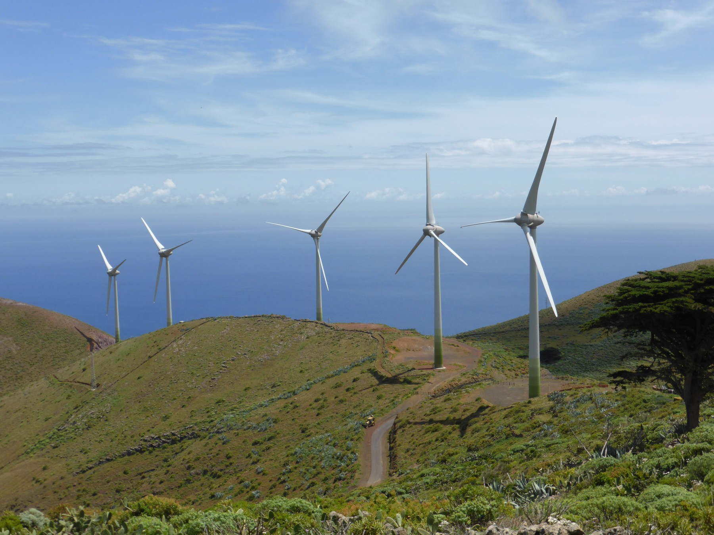

# WorldLab
**A Karma42 mission: play how the world works.**

[Join the mission on Karma42](https://karma42.ai/viewer/?project=583a34c26e7c2a6a8dccad7df8e35103e586460387189f2a5b18ec1391cf9ca2)

Power an island. Restore an ecosystem. Discover how one change can reshape a whole system. People and their agents build a free, growing universe of playable scientific worlds.

*Photographic reference, not a WorldLab deployment. CARLOS TEIXIDOR CADENAS, CC BY-SA 3.0. Resized. [Full credit and source](CREDITS.md).*

## First goal: Power an Island Through the Night

Launch one polished browser experience balancing solar generation, wind, battery storage and changing demand over a day and night.

- [ ] A documented model with explicit units, equations, assumptions and limitations.
- [ ] Three working challenges: an ordinary day, a cloudy day and a low-wind night.
- [ ] Players can change generation, storage and demand and inspect the effects.
- [ ] Automated energy-accounting and edge-case checks.
- [ ] Keyboard and touch input, non-color cues and a downloadable offline edition.
- [ ] Recruit a willing STEM educator to review the science and define an unfamiliar transfer question.
- [ ] Observe a small learner pilot and record whether players can explain the energy tradeoff.

This is an educational model, not engineering advice. Reviewers and pilot participants have not been recruited. This repository currently contains the mission brief and reference photograph; the playable experience is the first implementation goal.

## Many independent contributions, one coherent experience

Establish the world player and module contract first. Contributors can then develop independent worlds, challenges, art, sound, translations, accessible interactions and scientific tests. Each module should include its model, reference tests, source manifest, assumptions and learning goal.

Keep changes small and reviewable. Independent agents can build and cross-check different packages. People guide the mission and approve releases. Measure accepted, useful experiences and reviewer time as participation grows.

## Start contributing

Use a pull request to propose one bounded contribution against the first goal. Describe its purpose, evidence, how it was checked, remaining uncertainty and any AI assistance. Do not claim successful learning or accessibility until intended learners have evaluated it. Respect current contributor availability and review capacity.

Use original code and appropriately licensed assets. Record attribution and reuse conditions per source. A code license and contribution terms must be selected before accepting outside implementation contributions; this starter does not imply that third-party material is relicensed.

## Evidence and inspiration

- [PhET Global](https://phet.colorado.edu/en/phet-global)
- [PhET inclusive design and current accessibility coverage](https://phet.colorado.edu/en/inclusive-design/accessibility-statement)
- [PhET licensing](https://phet.colorado.edu/en/licensing/)

WorldLab is an independent initiative. No PhET partnership or permission to copy its simulations, branding or code is assumed.
